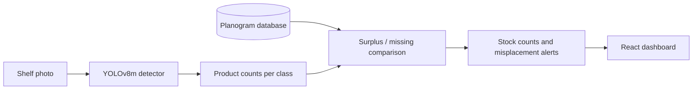

# ShelfSense: AI-Powered Retail Shelf Monitoring

**Turn one photo of a store shelf into live stock counts and misplaced-product alerts.**

ShelfSense is an end-to-end computer vision system built for small retailers who can't afford enterprise shelf-monitoring tools. A shopkeeper takes a photo of a shelf, and ShelfSense detects every product, compares it with the expected layout (planogram), and reports what is missing, what is surplus, and what is in the wrong place.

Built as my final-year B.Tech project at Manipal University Jaipur, and field-tested in a real grocery store, **Mahavir Provision, Indore**.

<!-- Replace with a screenshot or GIF of the dashboard. Put the file in docs/ and keep it under ~5 MB. -->


---

## Results

| Metric | Value |
|---|---|
| mAP@50 | **0.953** |
| Precision | [add from results.csv] |
| Recall | [add from results.csv] |
| mAP@50-95 | [add from results.csv] |
| Product classes | 8 |
| Real images collected and labeled | 1,436 |
| Training images after augmentation | ~6,454 |
| Planogram scenarios field-tested | 13 |

Model: YOLOv8m (Ultralytics), trained on a custom dataset.

---

## Why this project is different

- **Real data, not a Kaggle dataset.** I photographed and hand-labeled all 1,436 shelf images myself, then expanded them to about 6,454 with augmentation.
- **Tested in a real store.** The final demonstration ran on real shelves at Mahavir Provision, a grocery store in Indore.
- **A full product, not just a notebook.** It includes a trained detector, the comparison logic, a FastAPI backend with a database, and a React dashboard.

---

## How it works



1. **Detect:** a custom-trained YOLOv8m model finds and labels every product in the photo.
2. **Count:** detections are grouped by product class.
3. **Compare:** the counts are compared with the expected planogram stored in the database. Any class with more items than expected (surplus) or fewer than expected (missing) is flagged, and a surplus on one shelf together with a gap on another signals a misplaced product.
4. **Calibrate:** the expected ("ideal") shelf is set automatically from a single reference photo, so a shop owner doesn't have to type in a planogram by hand.
5. **Report:** results appear on the dashboard.

### A design decision that mattered

My first version found misplaced products by clustering detections into shelf columns. In real store photos this was unreliable, and misplacements were missed. <!-- Add one line on WHY clustering failed, in your own words. --> I replaced it with the count-based surplus/missing comparison above, which fixed the missed alerts and is simpler to reason about.

---

## Dataset

- **Source:** my own photos of real retail shelves
- **Size:** 1,436 original images, ~6,454 after augmentation
- **Classes:** 8 products: [list the 8 class names]
- **Labeling tool:** [e.g. Roboflow / LabelImg / CVAT]
- **Augmentations:** [e.g. flips, rotation, brightness, blur]

<!-- If the dataset is too large for GitHub, host it on Google Drive / Roboflow and link it here. -->


---

## Tech stack

| Layer | Tools |
|---|---|
| Detection model | Python, YOLOv8 (Ultralytics) |
| Backend | FastAPI, SQLAlchemy, SQLite |
| Frontend | React, Vite |
| Depth prototype | iPhone Pro LiDAR |

---

## Project structure

<!-- Update this to match your actual folders. -->
```
shelfsense/
├── backend/          # FastAPI app, database models, comparison logic
├── frontend/         # React + Vite dashboard
├── model/            # training notebooks/scripts, data.yaml
├── weights/          # best.pt (or download link below)
├── docs/             # screenshots and GIFs for this README
└── README.md
```

---

## Getting started

### Requirements
- Python 3.10+
- Node.js 18+

### 1. Clone the repository
```bash
git clone https://github.com/YOUR-GITHUB-USERNAME/shelfsense.git
cd shelfsense
```

### 2. Run the backend
```bash
cd backend
python -m venv venv
source venv/bin/activate        # Windows: venv\Scripts\activate
pip install -r requirements.txt
uvicorn main:app --reload
```
The API runs at `http://localhost:8000` (interactive docs at `/docs`).

### 3. Run the frontend
```bash
cd frontend
npm install
npm run dev
```
The dashboard runs at `http://localhost:5173`.

### 4. Model weights
Place `best.pt` in `weights/`, or download it here: [add link]

<!-- Check these commands and file names (main:app, requirements.txt) match your code. -->

---

## Work in progress: LiDAR depth mapping

A single photo only shows the front row of a shelf. One visible packet can hide up to 10 more behind it. I'm prototyping **depth mapping with an iPhone Pro's LiDAR sensor** to estimate how much stock sits behind the front-facing products. This part is not yet fully integrated with the detection pipeline.

---

## Known limitations

- **Look-alike products:** classes with very similar packaging are sometimes confused.
- **Front row only:** without depth data, hidden stock behind the first item isn't counted (see LiDAR above).
- **8 classes:** adding new products requires new labeled photos and retraining.

## Future work

- Finish LiDAR integration for hidden-stock estimation
- Add more product classes
- A mobile app so shop owners can scan shelves directly

---

## Author

**Suryansh Jain** · B.Tech (Hons.) CSE (AI & ML), Manipal University Jaipur
[LinkedIn](https://www.linkedin.com/in/YOUR-LINKEDIN-ID) · [Email](mailto:jainsuryansh1009@gmail.com)
